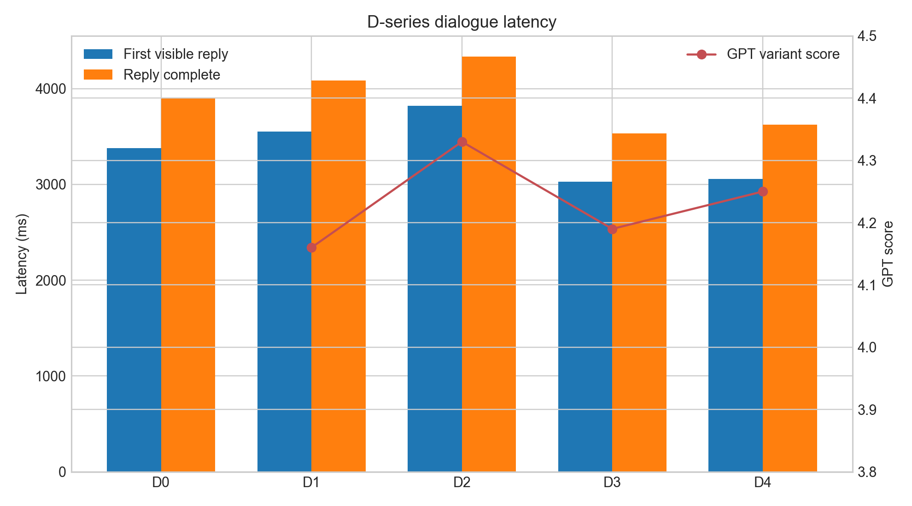
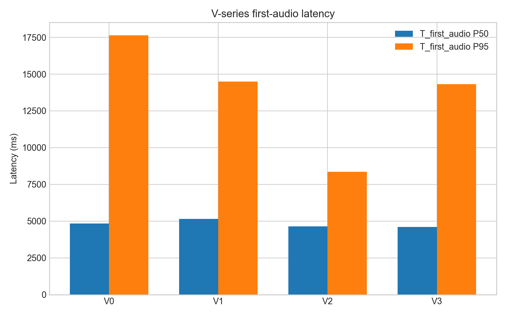
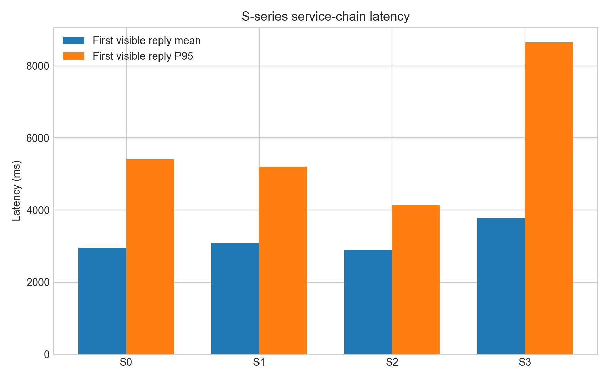

# 消融实验结果汇总

## 实验说明

- 当前 D/V/S 实验均使用切换后的 DeepSeek Flash 对话模型。
- D 系列性能数据为每组 12 条成功 WebSocket 请求；GPT 质量评审为每个对比组 12 个案例、每例 3 次随机化裁决，共 36 条有效裁决。
- V 系列为每组 6 条短、中、长语音案例，各重复 3 次，共 18 条成功请求。
- S 系列为每组 12 条成功 WebSocket 请求；音乐解析链路已额外完成 Backblaze 音频 URL、Server B 入队、Server A 分析和结果回传的功能验证。
- `T_first_visible_reply` 表示首个可见文本回复时延；`T_first_audio` 表示客户端收到首个音频 URL 的时延。

## 表 1 对话智能层 D 系列结果

| 组别 | 配置变化 | 首个可见回复均值 (ms) | 回复完成均值 (ms) | GPT 平均分 | D0 胜/负/平 |
|---|---|---:|---:|---:|---:|
| D0 | 完整对话智能基线 | 3379 | 3905 | - | - |
| D1 | 关闭对话策略层 | 3552 | 4083 | 4.16 | 19 / 15 / 2 |
| D2 | 关闭稳定记忆与事件记忆 | 3822 | 4335 | 4.33 | 16 / 19 / 1 |
| D3 | 关闭画像与音乐信号 | 3030 | 3533 | 4.19 | 21 / 11 / 4 |
| D4 | 关闭软确认机制 | 3058 | 3625 | 4.25 | 18 / 15 / 3 |

GPT 平均分为共情性、相关性、自然度、连续性、非说教性、安全边界与个性化七个维度的平均值。D0 在 D1、D3、D4 三项对比中的对应平均分分别为 4.25、4.31、4.26；D0 对 D2 的平均分为 4.19。

图 1 展示 D 系列的首个可见回复时延、回复完成时延，以及各消融组的 GPT 平均质量得分。

**结果分析。** D2 的首个可见回复和回复完成时延最高，均值分别为 3822 ms 与 4335 ms，且首个可见回复 P95 达到 9100 ms，说明当前模型配置下记忆相关链路带来了较明显的尾部波动。D3 与 D4 的响应更快，表明画像、音乐信号和软确认会产生一定额外处理开销。质量评审中，D3 的差异最清晰，D0 以 21:11:4 的胜负平结果领先，说明画像和音乐弱信号对陪伴式回复的整体质量具有正向作用。D2 的消融组平均分略高于 D0，说明当前 DeepSeek Flash 下的记忆注入仍需要控制冗余上下文和召回质量；该现象应作为系统优化发现呈现，而不宜据此否定记忆模块的设计价值。

## 表 2 语音交互层 V 系列结果

| 组别 | 配置变化 | 首段语音均值 (ms) | 首段语音 P50 (ms) | 首段语音 P95 (ms) | 回复完成均值 (ms) | 成功率 |
|---|---|---:|---:|---:|---:|---:|
| V0 | 完整句级流水线 | 5602 | 4837 | 17639 | 5602 | 100% |
| V1 | 关闭句级流水线 | 5888 | 5151 | 14500 | 5888 | 100% |
| V2 | 单线程 TTS | 5152 | 4640 | 8360 | 5152 | 100% |
| V3 | 收紧句子与音频队列 | 5764 | 4602 | 14314 | 5764 | 100% |

图 2 对比 V 系列首段语音时延的 P50 与 P95 分位数。

**结果分析。** 四组均成功返回音频，首段语音均值位于 5152-5888 ms 之间。V2 的平均时延和 P95 均最低，表明本次低并发、短中长混合样本下，单线程 TTS 未形成明显排队瓶颈。V1 的首段语音均值最高，相比 V0 增加约 286 ms，说明关闭流水线会增加用户等待首段语音的时间。V0 的 P95 为 17639 ms，显示完整流水线在少数请求中仍存在较大波动；后续可针对慢请求检查 TTS 服务耗时与网络状态。当前 UniApp 客户端每轮接收一个 `reply_audio`，因此本表反映端到端语音回复时延，不将其解释为多音频片段之间的连续播放效果。

## 表 3 服务链路层 S 系列结果

| 组别 | 配置变化 | 首个可见回复均值 (ms) | 首个可见回复 P95 (ms) | 回复完成均值 (ms) | 回复完成 P95 (ms) | 成功率 |
|---|---|---:|---:|---:|---:|---:|
| S0 | 完整异步服务链路 | 2953 | 5411 | 3641 | 5934 | 100% |
| S1 | 同步等待音频分析 | 3077 | 5204 | 3702 | 5469 | 100% |
| S2 | 关闭画像缓存 | 2890 | 4131 | 3451 | 4815 | 100% |
| S3 | 关闭音频情绪分析 | 3766 | 8648 | 4375 | 8912 | 100% |

图 3 对比 S 系列首个可见回复时延的均值与 P95 分位数。

**结果分析。** S0-S3 均保持 100% 请求成功率，说明异步服务切换和画像链路在实验环境中可稳定工作。S1 的首个可见回复均值较 S0 增加约 124 ms，说明同步等待分析会给主对话链路增加额外等待。S2 在本轮请求中时延最低，表明缓存失效的影响受当前数据命中情况、网络状态及画像数据规模共同影响，需结合部署日志进一步解释。S3 的各项时延最高，首个可见回复 P95 为 8648 ms、回复完成 P95 为 8912 ms，表明关闭音频情绪分析并未简单地减少处理开销，系统仍存在依赖切换与降级路径的尾部波动。音乐解析功能验证中，Backblaze AAC 地址已成功经 Server B Redis 队列分发至 Server A，完成分析并回传 Server B，证明该异步任务链路具备端到端可用性。

## 结论概述

现有实验共包含 180 条成功 WebSocket 性能记录与 144 条有效 GPT 裁决，覆盖对话智能、语音交互和异步服务链路三个层次。结果表明，系统在全部实验组中保持稳定可用；不同模块配置会对平均时延、P95 尾部时延和对话质量产生可观察差异。后续论文撰写应以系统功能验证和场景化性能比较为主，避免将当前样本规模表述为大样本统计显著性结论。
